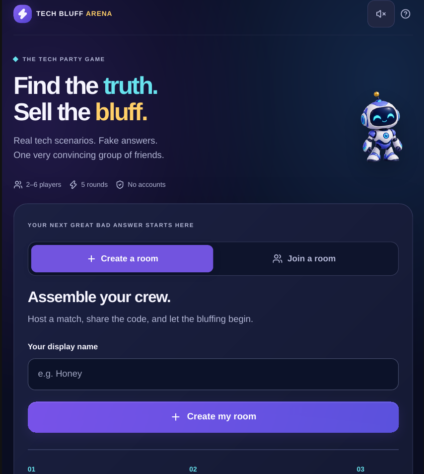

# Tech Bluff Arena — Multiplayer Tech Party Game

**Find the truth. Sell the bluff.**

Tech Bluff Arena is a multiplayer tech bluffing party game. Each round presents a real tech scenario — players write fake-but-believable answers, then everyone votes for the one they think is true. You score points for spotting the truth — and for fooling everyone else with your bluff.

🎮 **Play it live:** https://tech-bluff-arena.thjrartistry.chatgpt.site/
🏆 **Handshake AI Showcase:** https://app.joinhandshake.com/ai-showcase/projects/3543132 *(Handshake account/sign-in may be required to view)*

## Gallery

*The game's home screen — create a room, share the code, and start bluffing. No login; just a name and your best poker face.*

## How it plays

- **2–6 players**, joined by room codes — no accounts needed
- **5 rounds** per game
- Scenarios across **AI, Cybersecurity, Web Development, Data, Cloud, and DevOps**
- Write a bluff, vote for the truth, score for spotting it — and for fooling the room
- **Bot players** fill the room when you're short on humans
- Original music and sound effects

## About this project

Built for the **Handshake AI Showcase** and completed on **October 7, 2026**.

This repository is the project's showcase page. The game itself is played live at the link above; source files can be added here in the future.

## Author

**Honey-Leen Jamiro Rivera**
GitHub: https://github.com/honeyleenjr
LinkedIn: https://www.linkedin.com/in/honeyleenjr
